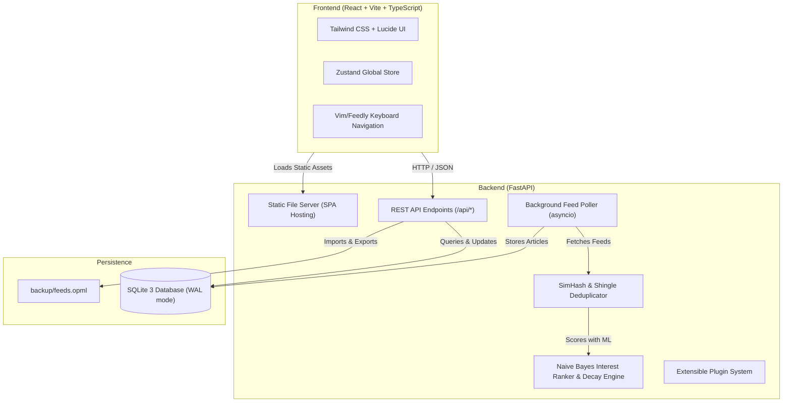

# Feeda 📰✨

Feeda is a modern, self-hosted smart RSS reader designed for speed, clarity, and intelligent content discovery. It combines automated feed polling, full-text search, near-duplicate clustering, personal research boards, and an adaptive machine learning interest ranker that learns what you like over time.

---

## 🌟 Key Features

- **Adaptive ML Interest Ranking (Naive Bayes)**: Learns from your reading habits, upvotes, stars, dwell time, and read actions. Automatically surfaces high-value content in the "For You" view and filters out noise.
- **Intelligent Near-Duplicate Detection & Clustering**: Groups similar breaking news stories across multiple RSS sources (using SimHash and title shingle similarity), showing a single clean entry with multi-source attribution.
- **Personal Research Boards**: Save articles with markdown notes to dedicated boards (similar to Feedly Boards or Pocket collections).
- **OPML 2.0 Import & Export**: Seamlessly migrate to and from Feeda with full folder and category hierarchy preservation. A live backup is maintained in `backup/feeds.opml`.
- **Keyboard-First Power User UX**: Super-fast Vim/Feedly-style keyboard navigation (`j`/`k`, `g t`, `g f`, `m`, `s`, `v`, `b`, `/`).
- **Clean Responsive Dark-First UI**: Built with React, Tailwind CSS, Lucide icons, and optimized for desktops, tablets, and mobile devices.
- **Self-Hosted & Ultra-Lightweight**: Runs anywhere with Python 3.10+ and SQLite — including Android phones via Termux!

---

## 💻 System Requirements

- **Python**: 3.10 or higher
- **Node.js**: 18.x or higher (for building the frontend)
- **OS**: Linux, macOS, Android (via Termux), or Windows (WSL recommended)

---

## 🚀 Quick Start (Linux / macOS / Windows)

Setting up Feeda from scratch on any machine takes less than 2 minutes:

### 1. Clone the Repository
```bash
git clone git@github.com:schdef/feeda.git
cd feeda
```

### 2. Configure Environment (Optional)
Feeda works out of the box with default settings, but you can configure ports, host bindings, and paths via `.env`:
```bash
cp .env.example .env
```
Default configuration values:
- `FEEDA_PORT=11666`
- `FEEDA_HOST=0.0.0.0`
- `FEEDA_DB_PATH=feeda.db`
- `FEEDA_POLL_INTERVAL=30`
- `FEEDA_STATIC_DIR=../frontend/dist`

### 3. Backend Setup
```bash
cd backend
python3 -m venv .venv
source .venv/bin/activate
pip install --upgrade pip
pip install -r requirements.txt
cd ..
```

### 4. Frontend Build
```bash
cd frontend
npm install
npm run build
cd ..
```

### 5. Launch the Server
You can launch Feeda using the root launch script:
```bash
./start.sh
```
Or directly with Python:
```bash
cd backend
source .venv/bin/activate
python -m feeda
```

Open your browser at **`http://localhost:11666`** (or your machine's local network IP).

---

## 📥 Restoring & Backing Up Feeds (OPML)

Feeda includes automated backup and full OPML 2.0 portability.

### Restoring Feeds:
1. **Via Web UI**:
   - Open Feeda in your browser.
   - Click the **Settings** gear icon in the sidebar.
   - Under **OPML Import / Export**, click **Import OPML** and select `backup/feeds.opml` (or any OPML file exported from Feedly, Inoreader, NetNewsWire, etc.).
2. **Via API**:
   ```bash
   curl -F "file=@backup/feeds.opml" http://localhost:11666/api/feeds/opml/import
   ```

### Backing Up Feeds:
- Export your feeds anytime via the Settings UI or directly via the export endpoint:
  ```bash
  curl -s http://localhost:11666/api/feeds/opml/export -o backup/feeds.opml
  ```

---

## 📱 Android / Termux Setup

Feeda can run 24/7 on an Android phone using Termux. We recommend using **proot-distro Debian** for reliable C-extensions and SQLite support.

### One-Click Setup on Device:
In Termux, clone the repo and run the automated setup script:
```bash
git clone git@github.com:schdef/feeda.git ~/feeda
cd ~/feeda
./scripts/termux/setup-termux.sh
```

### Managing the Service:
The setup script copies helper scripts to your Termux `$HOME`:
- **Start**: `~/start_feeda.sh` (acquires `termux-wake-lock`, launches Feeda in the background, writes to `~/feeda.log`)
- **Status**: `~/status_feeda.sh` (shows running PID, API health check, and recent logs)
- **Stop**: `~/stop_feeda.sh` (gracefully stops Feeda and releases wake lock)

### Remote Deployment Helper:
To build and deploy updates from your development workstation directly to your Termux device over SSH:
```bash
./scripts/termux/deploy.sh user@<phone-ip> 8022
```

---

## ⌨️ Keyboard Shortcuts Cheat Sheet

Press `?` anywhere in the app to display the full shortcuts cheat sheet.

| Shortcut | Description |
|---|---|
| **Navigation** | |
| `j` / `k` | Next / Previous article |
| `g` then `t` | Go to **Today** view |
| `g` then `f` | Go to **For You** (ML Ranked) view |
| `g` then `u` | Go to **Unread** view |
| `g` then `s` | Go to **Starred** view |
| `g` then `a` | Go to **All Articles** view |
| **Likelihood / Priority** | |
| `1` | Filter: **Likely / High Priority** only |
| `2` | Filter: **All Articles** |
| `3` | Filter: **Less Likely / Low Priority** |
| `l` | Cycle likelihood filter (Likely ➔ All ➔ Less Likely) |
| **Article Actions** | |
| `m` | Toggle Read / Unread |
| `s` | Toggle Star / Unstar |
| `v` | Open original article in new browser tab |
| `b` | Open **Personal Boards** switcher & note saver |
| `r` | Refresh current feed (or all feeds) |
| `/` | Focus search bar |
| `Shift + A` | Mark all articles as read |
| `Shift + D` | Mark articles older than 1 day as read |
| `Shift + W` | Mark articles older than 1 week as read |
| `Esc` | Close dialogs / Deselect active article |

---

## 🏗️ Architecture Overview



### Component Details:
- **Backend**:
  - `feeda/app.py`: FastAPI application factory, lifespan startup/shutdown hooks, migration runner, and static mount.
  - `feeda/routers/`: Modular route handlers for `articles`, `feeds`, `folders`, `boards`, and `settings`.
  - `feeda/services/feed_poller.py`: Non-blocking async background worker that polls RSS/Atom feeds, respects intervals, handles proxy fallbacks, and triggers ML re-scoring and time-decay.
  - `feeda/services/ranker.py`: Term frequency and Naive Bayes score calculations based on user interaction signals.
  - `feeda/services/dedup.py`: Near-duplicate detection combining Jaccard similarity over word shingles and SimHash bit distances.
  - `feeda/services/llm_dedup.py`: Multi-source clustering and chronological priority resolution.
- **Frontend**:
  - `frontend/src/stores/appStore.ts`: Centralized Zustand state for feeds, articles, boards, unread counts, and active views.
  - `frontend/src/hooks/useKeyboard.ts`: Complete keyboard event loop with 2-key chord navigation.
  - `frontend/src/components/`: Modular components including `ArticleList`, `ArticleDetail`, `Sidebar`, `PersonalBoards`, `ShortcutsModal`, and `SettingsModal`.
- **Database**:
  - SQLite with WAL (Write-Ahead Logging) for concurrent reads and writes, managed with lightweight, sequential SQL/Python migrations (`backend/migrations/`).

---

## 🧪 Testing

Feeda includes a comprehensive test suite covering ML interest ranking monotonicity, deduplication, SimHash matching, personal boards, OPML import/export, and API contracts.

Run the test suite:
```bash
./backend/.venv/bin/python tests/test_ml_and_dedup.py
```

---

## 📄 License

MIT License. Feel free to use, modify, and distribute.
